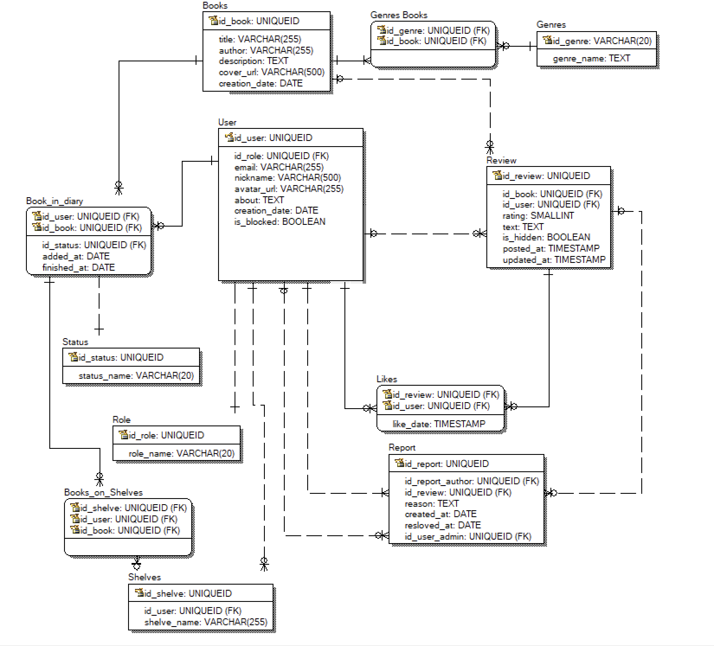

# Требования к веб-приложению «Читательский дневник»

## Первичные требования

- веб-приложение / Web API (ASP.NET Core, СУБД PostgreSQL)
- есть пользователи, роли, книги, жанры, статусы чтения, отзывы, лайки, полки, жалобы
- читатели ведут дневник: добавляют прочитанные книги, ставят оценку **от 1 до 5** звёзд, пишут короткий отзыв
- читатели смотрят ленту отзывов других читателей
- читатели раскладывают книги по своим полкам и отмечают статус чтения (прочитано / читаю сейчас / хочу прочитать)
- администратор модерирует отзывы по жалобам, управляет пользователями, ролями и справочником жанров

---

## Минимальные требования

### Анонимный посетитель

- открыть в браузере
- без регистрации просмотреть ленту отзывов
- поиск/фильтрация книг по названию / автору / жанру
- просмотреть карточку книги (название, автор, описание, жанры, средняя оценка, отзывы)
- просмотреть список жанров
- при желании зарегистрироваться

### Зарегистрированный пользователь (читатель)

- всё, что доступно анониму
- зарегистрироваться / войти по email и паролю
- редактировать свой профиль (имя, аватар, «о себе»)
- добавить книгу в каталог, если её там ещё нет (название, автор, описание, обложка, жанры)
- добавить книгу в свой дневник со статусом (прочитано / читаю / хочу прочитать)
- изменить статус книги, указать дату прочтения, удалить книгу из дневника
- создать / переименовать / удалить полку
- положить книгу на полку / убрать с полки
- посмотреть свой дневник (фильтр по статусу, полке, жанру, оценке; поиск по названию)
- оставить отзыв на прочитанную книгу: оценка **от 1 до 5** и короткий текст
- редактировать / удалить свой отзыв
- поставить / убрать «нравится» чужому отзыву
- пожаловаться на отзыв (с указанием причины)

### Администратор

- войти в ЛК
- посмотреть список пользователей
- сменить роль пользователя
- заблокировать / разблокировать / удалить пользователя
- посмотреть список жалоб (по статусам)
- открыть жалобу и посмотреть отзыв, на который она подана
- скрыть отзыв / вернуть скрытый отзыв
- закрыть жалобу (решена / отклонена)
- управлять справочником жанров (добавить, изменить, удалить)
- объединить дубликаты книг в каталоге
- редактировать / удалить любую книгу
- весь функционал обычного пользователя

---

## Этапы реализации

- **PoC (proof of concept):** регистрация и вход, добавление книги в дневник, оценка и отзыв, просмотр своего дневника
- **MVP (PoC +):** статусы чтения, полки, лента отзывов, поиск и фильтры, лайки отзывов, жалобы, модерация

---

## Технические требования

- в системе существуют **3 роли** — аноним, пользователь, администратор; роли и статусы чтения хранятся в справочниках
- **аноним** — не хранится в БД
- возможность авторизации, регистрации
- пароль не хранится в открытом виде, в базе данных хранится **хэш пароля**
- оценка — целое число **от 1 до 5**
- оставлять отзывы, ставить лайки, создавать полки и подавать жалобы могут **только зарегистрированные пользователи**
- лента отзывов выдаётся **постранично**, **новые отзывы сверху**
- модель данных, ER-диаграмма и скрипт создания БД описаны в отдельных документах

### Бизнес-правила

**Правило регистрации:**

Почта уникальна без учёта регистра. Заблокированный пользователь войти не может.

**Правило каталога:**

Книга хранится в общем каталоге один раз (пара «название + автор» уникальна). Читатели добавляют в свой дневник ссылку на книгу из каталога, а не создают копию.

**Правило дневника:**

Одна книга может быть в дневнике пользователя только один раз. Дата прочтения указывается только для статуса «прочитано».

**Правило отзыва:**

Отзыв можно оставить только на книгу, которая есть в дневнике пользователя со статусом «прочитано». На одну книгу у пользователя может быть только один отзыв.

**Правило оценки:**

Оценка обязательна и находится в диапазоне от 1 до 5. Текст отзыва необязателен, не более 2000 символов. Средний рейтинг книги считается только по видимым отзывам.

**Правило полок:**

Название полки уникально в пределах пользователя. На полку можно положить только книгу из дневника её владельца. При удалении книги из дневника она исчезает со всех полок.

**Правило жалобы:**

Пользователь может подать на один отзыв только одну жалобу. На собственный отзыв жаловаться нельзя.

**Правило модерации:**

Скрыть и вернуть отзыв может только администратор. При рассмотрении жалобы фиксируются дата рассмотрения и администратор, который её рассмотрел.

**Правило видимости:**

Скрытые отзывы, а также отзывы заблокированных пользователей не видны в ленте и в карточке книги. Автор скрытого отзыва видит его в своём дневнике с пометкой «скрыт модератором».

**Правило жанров:**

Жанр, который присвоен хотя бы одной книге, удалить нельзя.

**Правило удаления:**

При удалении пользователя удаляются его дневник, полки, отзывы, лайки и поданные им жалобы. Книги в каталоге остаются.
